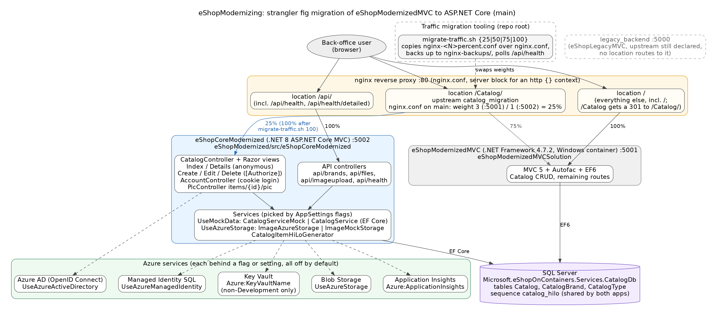

# Architecture: strangler fig migration to ASP.NET Core

This document describes the setup on `main`: the eShopModernizedMVC catalog back-office app (.NET Framework 4.7.2) being replaced route by route by **eShopCoreModernized** (.NET 8 ASP.NET Core MVC) behind an nginx reverse proxy. The other samples in this repo (legacy/modernized WebForms, WCF + WinForms N-Tier, and the ACI, VM, Kubernetes and Service Fabric deployment assets) are the original lift-and-shift samples described in the [README](../README.md); nginx does not route to them.



The diagram source is [`diagrams/architecture.dot`](diagrams/architecture.dot) (Graphviz). After editing it, run `docs/diagrams/render.sh` to regenerate [`architecture.png`](diagrams/architecture.png) and [`architecture.svg`](diagrams/architecture.svg).

## Components

| Component | Where | Runtime | Port nginx expects |
|-----------|-------|---------|--------------------|
| nginx reverse proxy | [`nginx.conf`](../nginx.conf) | nginx | listens on 80 |
| eShopCoreModernized | [`eShopModernized/src/eShopCoreModernized`](../eShopModernized/src/eShopCoreModernized) | .NET 8 (`net8.0`), Kestrel | 5002 (`core_backend`) |
| eShopModernizedMVC | [`eShopModernizedMVCSolution`](../eShopModernizedMVCSolution) | .NET Framework 4.7.2, IIS / Windows container | 5001 (`modernized_backend`) |
| eShopLegacyMVC | [`eShopLegacyMVCSolution`](../eShopLegacyMVCSolution) | .NET Framework 4.7.2 | 5000 (`legacy_backend`, declared but no `location` uses it) |
| Catalog database | SQL Server, `Microsoft.eShopOnContainers.Services.CatalogDb` | SQL Server | 1433 (5433 on the host in `docker-compose.override.yml`) |

Both apps use the same tables (`Catalog`, `CatalogBrand`, `CatalogType`) and the `catalog_hilo` sequence for IDs, so they can run against one database during the migration.

## Request routing

The `.conf` files at the repo root hold `upstream` and `server` blocks only, so they must be included from an `http {}` block (for example as a file in `/etc/nginx/conf.d/`); `nginx -c nginx.conf` on its own fails with `"upstream" directive is not allowed here`.

| Path | Upstream | Goes to |
|------|----------|---------|
| `/api/` (including `/api/health` and `/api/health/detailed`) | `core_backend` | eShopCoreModernized, 100% |
| `/Catalog/` and everything below it (nginx answers `/Catalog` with a 301 to `/Catalog/`) | `catalog_migration` | weighted split between :5001 and :5002, see below |
| `/` (everything else, including `/` itself) | `modernized_backend` | eShopModernizedMVC, 100% |

### Traffic migration stages

[`migrate-traffic.sh`](../migrate-traffic.sh) `{25|50|75|100}` backs up the current `nginx.conf` to `nginx-backups/nginx-<epoch>.conf`, copies the matching stage file over `nginx.conf` and polls `http://localhost/api/health` once a second for 300 seconds. It does not reload nginx or copy the file into `/etc/nginx`; do that yourself (`sudo nginx -s reload`).

| Stage file | `catalog_migration` weights | `/Catalog/` to .NET 8 |
|------------|-----------------------------|-----------------------|
| [`nginx-25percent.conf`](../nginx-25percent.conf) | :5001 weight 3, :5002 weight 1 | 25% |
| [`nginx-50percent.conf`](../nginx-50percent.conf) | :5001 weight 1, :5002 weight 1 | 50% |
| [`nginx-75percent.conf`](../nginx-75percent.conf) | :5001 weight 1, :5002 weight 3 | 75% |
| [`nginx-100percent.conf`](../nginx-100percent.conf) | :5002 only | 100% |

**The `nginx.conf` committed on `main` is byte-for-byte identical to `nginx-25percent.conf`: it is the 25% stage, not the 100% final state.** Both files in `nginx-backups/` are 100%-stage configs (the older one still health-checks `/health` instead of `/api/health`), which suggests `migrate-traffic.sh 25` was run after the 100% cutover. Run `./migrate-traffic.sh 100` (and reload nginx) to reach the end state that [MIGRATION-COMPLETE.md](../MIGRATION-COMPLETE.md) describes.

## eShopCoreModernized

* **MVC**: `CatalogController` with the Razor views migrated from the .NET Framework app. `Index` and `Details` are anonymous; `Create`, `Edit` and `Delete` require sign-in. The default route `{controller=Catalog}/{action=Index}/{id?}` makes `/` the catalog list when the app is hit directly.
* **Sign-in**: with `UseAzureActiveDirectory=false`, `AccountController` issues a cookie for any non-empty user name and password (a test stand-in, not real authentication). With it `true`, OpenID Connect through `Microsoft.Identity.Web` and the `Azure:ActiveDirectory` section.
* **API**: `api/brands`, `api/files`, `api/imageupload/upload`, `api/imageupload/default`, `api/health`, `api/health/detailed`.
* **Pictures**: `items/{id}/pic` (`PicController`); image URLs come from `IImageService` (`/pics/{id}/{file}` with mock storage, blob URLs with Azure Storage).
* **Service selection** (`Program.cs`, from `AppSettings` in `appsettings.json`):

| Setting | Default | `true` | `false` |
|---------|---------|--------|---------|
| `UseMockData` | `true` | `CatalogServiceMock` (in-memory) | `CatalogService` (EF Core, runs `EnsureCreated()` at startup) |
| `UseAzureStorage` | `false` | `ImageAzureStorage` (`BlobServiceClient`) | `ImageMockStorage` |
| `UseAzureManagedIdentity` | `false` | `ManagedIdentitySqlConnectionFactory` | `AppSettingsSqlConnectionFactory` |
| `UseAzureActiveDirectory` | `false` | OpenID Connect | cookie sign-in |

* **Key Vault**: loaded outside the Development environment when `Azure:KeyVaultName` is set, with `DefaultAzureCredential`.
* **Telemetry**: Application Insights (`Azure:ApplicationInsights:ConnectionString`) with `MigrationTelemetryInitializer` tagging telemetry for migration tracking.

## Running it locally

```bash
cd eShopModernized/src/eShopCoreModernized
dotnet build
ASPNETCORE_ENVIRONMENT=Development dotnet run --urls http://localhost:5002
# http://localhost:5002/                    catalog list (mock data)
# http://localhost:5002/api/health          {"status":"Healthy",...}
# http://localhost:5002/api/health/detailed service and flag status
```

The project has no `launchSettings.json`, so without `--urls` Kestrel listens on its default port 5000, not the 5002 nginx expects. To put nginx in front, include `nginx.conf` from an `http {}` block, start eShopModernizedMVC on 5001 and reload nginx.

In `docker-compose.override.yml` the service `eshop.core.modernized` is published as `5002:80` and `eshop.modernized.mvc` as `5115:80` (not 5001), so the compose ports and the nginx upstreams do not line up without changes.

## Related documents

* [README-Migration.md](../README-Migration.md): migration approach, dependency mapping and phase history.
* [MIGRATION-COMPLETE.md](../MIGRATION-COMPLETE.md): target end state and operations.
* [ROLLBACK-PROCEDURES.md](../ROLLBACK-PROCEDURES.md): moving traffic back to the .NET Framework app.
* [eShopCoreModernized README](../eShopModernized/src/eShopCoreModernized/README.md): project-level configuration.
